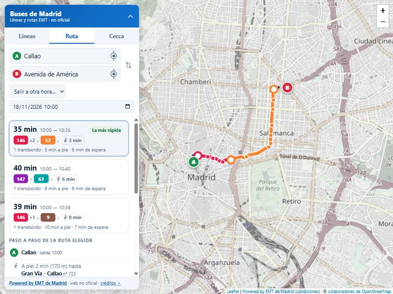

# Mapa de buses de Madrid

Mapa interactivo **no oficial** de las líneas de autobús urbano de la EMT de Madrid, con **buscador de rutas**.

En el plano del metro se ve de un vistazo cómo se conectan las líneas, pero con más de 200 líneas de autobús eso es imposible. Esta web te deja **elegir unas cuantas líneas, verlas pintadas sobre el mapa por sus calles reales y descubrir dónde se cruzan** para hacer transbordo. Y desde la v0.2, también **calcular cómo ir de un punto a otro** y ver **qué paradas tienes cerca**.


| Ruta entre dos puntos | Paradas cercanas |
| --- | --- |
|  |  |

<p align="center"></p>

> [**Powered by EMT de Madrid**](https://www.emtmadrid.es). Datos procesados a partir del GTFS oficial de la EMT (actualizado el 13/11/2026), sujetos a sus [condiciones de uso](https://mobilitylabs.emtmadrid.es/sip/terms-of-use). Esta web **no es una aplicación oficial de la EMT**.

## Qué hace

El panel tiene tres modos: **Líneas**, **Ruta** y **Cerca**.

### Líneas

- **Mapa a pantalla completa** (Leaflet + OpenStreetMap, sin API keys).
- **Lista de líneas** con buscador por número o nombre (`C1`, `27`, `Circular`…), selección múltiple y un color por línea que puedes cambiar.
- Cada línea se dibuja **por sus calles reales**, con sus paradas. Puedes ver la ida, la vuelta o ambas.
- Si varias líneas comparten calle **se dibujan en paralelo**, como en un plano de metro, en vez de taparse.
- **Paradas**: aparecen al acercar el zoom. Al pulsar una ves su nombre, su código y las líneas que pasan, con botones para seleccionarlas todas o para usarla como origen o destino de una ruta.
- **Transbordos**: con dos o más líneas seleccionadas se resaltan las paradas compartidas y las parejas de paradas de líneas distintas a menos de 250 m.
- **Buscador de paradas** por nombre o código.

### Ruta

- El **origen y el destino** pueden ser una parada (por nombre o código), una **calle, dirección o lugar** escrito a mano («Gran Vía 32», «IFEMA»), **tu ubicación** o un **punto tocado en el mapa**.
- Calcula hasta **3 rutas que sean variantes de verdad**: no la misma con cambios mínimos, sino por líneas o calles distintas.
- De cada ruta ves las líneas que hay que coger, la parada de subida y de bajada, los transbordos, los tramos a pie, la espera estimada y el **tiempo total**. Si varias líneas te sirven para un mismo tramo, te lo dice («coge la primera que pase»).
- La ruta elegida se **dibuja en el mapa** con el color de cada línea; los marcadores de origen y destino se pueden arrastrar.
- **Hora de salida**: por defecto «ahora», y se puede elegir otro día y hora (cambian las frecuencias, las líneas en servicio y los búhos).
- Si está cerca, también ofrece **ir andando**.

### Cerca

- Eliges un punto (una dirección, tu ubicación o un toque en el mapa) y un **radio de 100 a 1000 m** con un deslizador.
- Marca en el mapa las **paradas dentro del radio** y lista **todas sus líneas**, que puedes pintar una a una o todas a la vez.

### Además

- **Enlace compartible**: las líneas, la ruta (origen, destino y hora), el punto de «Cerca» y la vista del mapa se guardan en la URL.
- Funciona en **móvil**: el panel pasa a ser una hoja inferior plegable.

## Ejecutarlo en local

Es una web estática: no hay que instalar ni compilar nada, solo servir la carpeta con cualquier servidor web (abrir `index.html` con doble clic no funciona, porque el navegador no deja cargar los datos desde `file://`).

```bash
git clone https://github.com/joseagim/mapa-buses-madrid.git
```

```bash
cd mapa-buses-madrid
```

```bash
python -m http.server 8000
```

Y abre <http://localhost:8000>. Para probar algo rápido:

- Líneas: <http://localhost:8000/#l=C1,C2,27,73>
- Ruta: <http://localhost:8000/#t=ruta&o=40.4087,-3.6922,Atocha&d=40.4660,-3.6894,Plaza%20de%20Castilla>
- Cerca: <http://localhost:8000/#t=cerca&c=40.4203,-3.7059,300,Callao>

## Cómo se calculan las rutas

Todo el cálculo se hace **en el navegador**, sin servidor. Las decisiones principales:

### Datos: horario comprimido en franjas

El `stop_times.txt` de la EMT ocupa 100 MB (86.635 viajes), inviable para una web estática. Pero todos los viajes de una línea y sentido tienen el mismo perfil de tiempos entre paradas (solo cambia la duración total según la hora), y el propio GTFS trae en `frequencies.txt` la frecuencia de cada franja. Así que por cada **recorrido** (línea + sentido) se guarda:

- la lista de paradas y el perfil de tiempos;
- por cada tipo de día (laborable, viernes, sábado, festivo…), sus **franjas**: primera salida, última salida, número de salidas y duración del recorrido.

Eso son 397 KB (134 KB comprimido) en `data/emt/routing.json`, que solo se descarga al abrir el modo Ruta.

Al calcular una ruta, la espera depende de la franja:

- si pasan autobuses **cada 15 minutos o menos**, se cuenta **medio intervalo** (un autobús urbano no cumple un horario al minuto);
- si pasan **cada más de 15 minutos** (búhos, líneas especiales), se espera a la **siguiente salida**, como con un horario.

### Algoritmo: RAPTOR

[RAPTOR](https://www.microsoft.com/en-us/research/publication/round-based-public-transit-routing/) trabaja por rondas: en la ronda *k* calcula la llegada más temprana a cada parada usando como mucho *k* autobuses. Encaja bien con datos organizados por recorridos y es muy rápido: una consulta completa tarda unos 25 ms de media.

- **Transbordos a pie** entre paradas a menos de 300 m en línea recta, a 4,5 km/h y con un 25 % de rodeo. Se calculan en el navegador a partir de las coordenadas.
- **Origen y destino**: se consideran todas las paradas a menos de 800 m de cada punto, y los tramos a pie del principio y del final cuentan en el tiempo total.
- **Variantes**: como es tan rápido, se lanza varias veces vetando las líneas de la mejor ruta encontrada. De todas las candidatas se eligen las de menor coste (tiempo, más 5 min por transbordo, más un recargo por andar) descartando las que pasan por las mismas paradas que otra ya elegida.
- **Calendario**: la fecha elegida decide qué tipo de día se aplica, incluidos los festivos del GTFS. Los búhos, que en el GTFS salen «a las 24:00 y pico» del día anterior, se tienen en cuenta.

Está explicado con más detalle en los comentarios de `js/router.js`. Para comprobarlo con trayectos reales:

```bash
node tests/router.test.mjs --verbose
```

### Búsqueda de direcciones

Tampoco hay servidor propio para esto. Se evaluaron tres servicios gratuitos:

| Servicio | Decisión | Por qué |
| --- | --- | --- |
| [Photon](https://photon.komoot.io) (komoot, datos de OpenStreetMap) | **Principal** | Permite buscar mientras se escribe y encuentra calles, portales y lugares (IFEMA, estaciones, hospitales). Es un servidor público de «uso justo»: se le pregunta con pausa entre teclas, a partir de 3 letras, con caché y cancelando lo que ya no hace falta. |
| [CartoCiudad](https://www.cartociudad.es) (Instituto Geográfico Nacional) | **Respaldo** si Photon falla | Oficial y muy bueno con calles y portales, pero no conoce lugares por su nombre («IFEMA» o «Avenida de América» no devuelven nada). |
| [Nominatim](https://nominatim.org) (OpenStreetMap) | Descartado | Su [política de uso](https://operations.osmfoundation.org/policies/nominatim/) prohíbe el autocompletado y limita a 1 petición por segundo. |

Todas las búsquedas se limitan a la **Comunidad de Madrid**.

### Preparado para más redes

Los datos van «una carpeta por red» y el buscador de rutas une todas las redes que se le pasen: los recorridos se concatenan y los transbordos a pie salen de las coordenadas, así que los transbordos **entre redes** no necesitan nada especial. El formato de franjas también vale para horarios puros (un viaje suelto es una franja de una sola salida).

Para añadir los **interurbanos del CRTM** habrá que generar `data/crtm/` con el mismo script (`--input`, `--output`, `--network-id`, `--network-name`), registrar la red en `NETWORKS` (`js/config.js`) y hacer que `js/app.js` cargue las paradas y las líneas de más de una red, que hoy solo carga la EMT.

## Actualizar los datos

Los datos que usa la web están en `data/emt/` y se generan a partir del GTFS oficial con un script de Python (solo librería estándar, Python 3.9 o superior).

1. Descarga el GTFS de la EMT desde el [portal de datos abiertos del Ayuntamiento de Madrid](https://datos.madrid.es) (busca «EMT GTFS»).
2. Guárdalo como `data/raw/gtfs_emt.zip`. Esa carpeta está en `.gitignore`: el ZIP original **no** se sube al repositorio.
3. Ejecuta el script desde la raíz del repo:

   ```bash
   python scripts/build_data.py
   ```

4. Revisa el resumen que imprime (número de líneas, paradas, recorridos y franjas, avisos), pasa la prueba de rutas (`node tests/router.test.mjs`) y prueba la web en local.
5. Sube los cambios de `data/emt/` con un commit. La fecha que se muestra en la web se actualiza sola; acuérdate de cambiarla también en la cita de este README.

Tarda unos 15 segundos. Opciones útiles (`python scripts/build_data.py --help`):

| Opción | Para qué sirve |
| --- | --- |
| `--input RUTA` | Usar otro ZIP en vez de `data/raw/gtfs_emt.zip` |
| `--output CARPETA` | Escribir en otra carpeta en vez de `data/emt` |
| `--network-id ID`, `--network-name NOMBRE` | Identificar otra red (por ejemplo `crtm`) |
| `--tolerance METROS` | Simplificación de la geometría (por defecto 2 m) |
| `--date AAAA-MM-DD` | Fecha de actualización del GTFS (por defecto, la de los ficheros del ZIP) |

### Formato de los datos generados

```
data/emt/
├── index.json        metadatos del feed y lista de líneas
├── stops.json        todas las paradas, cada una con las líneas que pasan
├── lines/<id>.json   un fichero por línea (se carga solo al seleccionarla)
└── routing.json      datos del buscador de rutas (se carga al abrir el modo Ruta)
```

- **`index.json`** → `feed.date` (fecha del GTFS) y `lines`: `id`, `name` (número), `long` (nombre largo) y, por sentido, cabecera y número de paradas.
- **`stops.json`** → cada parada es `[id, código, nombre, lat, lon, [ids de línea]]`.
- **`lines/<id>.json`** → por cada sentido (`dir` 0 = ida, 1 = vuelta): `shape` (geometría simplificada, en formato [*encoded polyline*](https://developers.google.com/maps/documentation/utilities/polylinealgorithm) de precisión 5), `stops` (paradas en orden), `dist` (metros acumulados) y `time` (segundos acumulados desde la primera parada). Con `shape` y `dist` se recorta el tramo de calle que se dibuja en cada ruta.
- **`routing.json`** →
  - `services`: tipos de día (`days` de lunes a domingo, `from`, `to`) y `exceptions` (`[fecha, servicio, 1 = añadido | 2 = quitado]`);
  - `scheduleHeadway`: intervalo (s) a partir del cual una franja se trata como horario;
  - `patterns`: un recorrido por línea y sentido, con `line`, `dir`, `stops` (posiciones en `stops.json`), `time` (segundos acumulados) y `bands`: por servicio, una lista plana `[primera salida, última salida, nº de salidas, duración, …]` en segundos desde las 0:00 del día de servicio (pueden pasar de 24 h).

## Desplegarlo en GitHub Pages

No hace falta ningún paso de compilación:

1. En GitHub, entra en **Settings → Pages**.
2. En *Build and deployment → Source* elige **Deploy from a branch**.
3. Selecciona la rama **`main`** y la carpeta **`/ (root)`**, y pulsa **Save**.
4. En uno o dos minutos la web estará en `https://<tu-usuario>.github.io/mapa-buses-madrid/`.

Todas las rutas del proyecto son relativas, así que funciona igual en una subcarpeta.

## Estructura del proyecto

```
index.html             página única
css/style.css          estilos
js/app.js              lógica principal: datos, mapa, modo Líneas y cambio de modo
js/planner.js          modo Ruta: formulario, lista de rutas y dibujo en el mapa
js/router.js           buscador de rutas (RAPTOR); no toca el DOM
js/nearby.js           modo Cerca: paradas y líneas dentro de un radio
js/places.js           selector de lugar: paradas, direcciones, ubicación, punto del mapa
js/geocode.js          búsqueda de direcciones (Photon y CartoCiudad)
js/offset.js           dibujo de líneas en paralelo
js/transfers.js        transbordos entre las líneas seleccionadas
js/urlstate.js         estado en la URL
js/geo.js              utilidades (polilíneas, distancias, rejilla de cercanía, texto)
js/dom.js              utilidades de interfaz
js/config.js           configuración (colores, zooms, redes, parámetros de rutas)
scripts/build_data.py  preprocesado del GTFS
tests/router.test.mjs  prueba del buscador de rutas con trayectos reales
data/emt/              datos procesados (sí se suben al repo)
data/raw/              GTFS original (no se sube)
```

Es JavaScript sin dependencias ni *bundler* (módulos ES). Leaflet se carga desde un CDN.

### Cómo se dibujan las líneas en paralelo

Cada recorrido se desplaza unos píxeles hacia la **derecha de su sentido de marcha**. Cuánto se desplaza depende de cuántas de las líneas seleccionadas antes pasan por esa misma calle y en ese mismo sentido (su «carril»). Así, dos líneas que comparten calle van en carriles contiguos, y la ida y la vuelta quedan una a cada lado, como el tráfico real. Está explicado paso a paso en los comentarios de `js/offset.js`.

## Limitaciones conocidas

Del buscador de rutas:

- Los tiempos son **estimaciones** a partir de los horarios y frecuencias oficiales del GTFS: no hay tráfico ni tiempo real.
- Las distancias a pie son **en línea recta** con un factor de rodeo, no el recorrido real por las calles.
- Solo conoce los **autobuses de la EMT**: no combina con metro, cercanías ni interurbanos.
- Las tres rutas no siempre son igual de buenas: si solo hay uno o dos caminos razonables, la tercera puede ser claramente peor, o no salir.
- De madrugada, o con líneas de poco servicio, la mejor ruta puede incluir **esperas largas**; se avisa.
- No se puede seguir en el autobús al pasar por la cabecera de una línea (afecta a las circulares).
- La búsqueda de direcciones depende de un servidor público (Photon) sin garantía de disponibilidad; si falla se usa CartoCiudad, que no encuentra lugares por su nombre.

Del mapa de líneas:

- La distancia de los transbordos es **en línea recta**.
- La pestaña de transbordos no mira horarios: que dos líneas compartan parada no significa que funcionen a la vez (por ejemplo, una diurna y una nocturna).
- En el mapa no se indica con flechas el sentido de cada recorrido (se puede filtrar por ida o vuelta en el panel).
- Con muchas líneas por la misma calle, el «haz» de líneas en paralelo se hace ancho.
- Si una línea tiene variantes de recorrido, se dibuja solo la más frecuente (en el GTFS actual ninguna las tiene).
- El mapa base usa los servidores públicos de teselas de OpenStreetMap, pensados para un uso moderado. Si la web tuviera mucho tráfico habría que cambiar de proveedor.

Ideas para más adelante: capa e itinerarios con los interurbanos del CRTM, flechas de sentido, recorrido a pie por las calles.

## Datos y créditos

- **Datos de transporte**: [Powered by EMT de Madrid](https://www.emtmadrid.es). Son datos procesados a partir del GTFS oficial de la Empresa Municipal de Transportes de Madrid (versión del 13/11/2026), publicados en el portal de datos abiertos del Ayuntamiento de Madrid y sujetos a sus [condiciones de uso](https://mobilitylabs.emtmadrid.es/sip/terms-of-use). El procesado (simplificación de geometrías, índice de paradas, franjas de frecuencia) y las rutas y tiempos calculados son de este proyecto, y cualquier error que haya introducido también.
- **Mapa base**: © [colaboradores de OpenStreetMap](https://www.openstreetmap.org/copyright).
- **Búsqueda de direcciones**: [Photon](https://photon.komoot.io), de komoot, con datos © colaboradores de OpenStreetMap ([ODbL](https://opendatacommons.org/licenses/odbl/)). De respaldo, [CartoCiudad](https://www.cartociudad.es) © Instituto Geográfico Nacional ([CC BY 4.0](https://creativecommons.org/licenses/by/4.0/deed.es), scne.es).
- **Librería de mapas**: [Leaflet](https://leafletjs.com).

Este proyecto es personal, sin ánimo de lucro, y **no está afiliado a la EMT ni respaldado por ella**. No usa sus logotipos. Para información oficial y en tiempo real, usa los canales de la EMT.

## Desarrollado con Claude Fable 5.2

Este proyecto se ha desarrollado con **Claude Fable 5.2**, el modelo de Anthropic, usando [Claude Code](https://claude.com/claude-code). A partir de una descripción de lo que quería (funcionalidades, restricciones técnicas y requisitos legales), el modelo planificó el trabajo, escribió el script de preprocesado y la web, la probó en un navegador con capturas de pantalla y fue corrigiendo los fallos. Yo he revisado el resultado y decidido qué se publica.

## Licencia

El código se publica bajo licencia [MIT](LICENSE). Los datos de `data/emt/` derivan del GTFS de la EMT y se rigen por sus condiciones de uso, enlazadas arriba.
