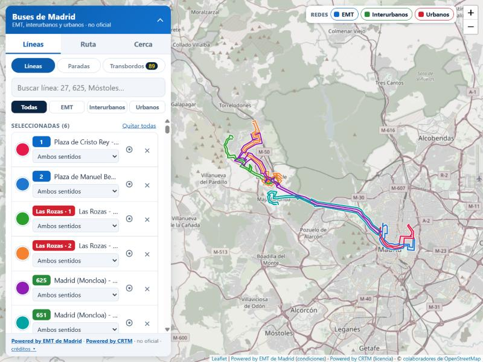
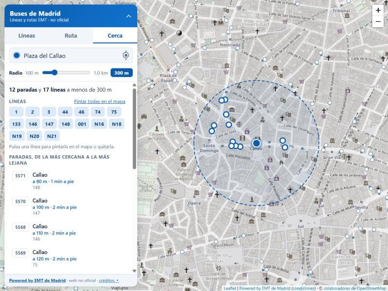
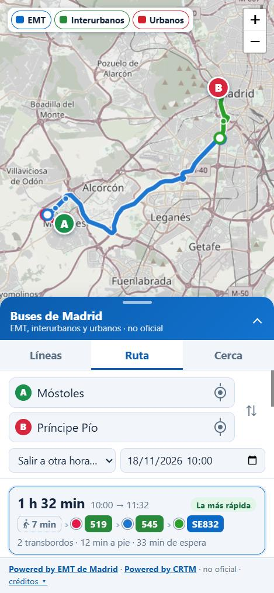
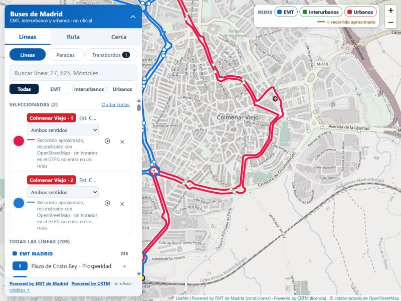

# Mapa de buses de Madrid

Mapa interactivo **no oficial** de los autobuses de Madrid, con **buscador de rutas**: la **EMT**, los **interurbanos** del Consorcio Regional de Transportes (CRTM) y los **urbanos de otros municipios** (Alcalá de Henares, Móstoles, Las Rozas, Getafe…).

En el plano del metro se ve de un vistazo cómo se conectan las líneas, pero con más de 700 líneas de autobús eso es imposible. Esta web te deja **elegir unas cuantas líneas, verlas pintadas sobre el mapa por sus calles reales y descubrir dónde se cruzan** para hacer transbordo, **calcular cómo ir de un punto a otro** combinando redes y ver **qué paradas tienes cerca**.



| Ruta entre dos puntos | Paradas cercanas |
| --- | --- |
|  |  |

<p align="center"></p>

> [**Powered by EMT de Madrid**](https://www.emtmadrid.es). Datos procesados a partir del GTFS oficial de la EMT (actualizado el 13/11/2026), sujetos a sus [condiciones de uso](https://mobilitylabs.emtmadrid.es/sip/terms-of-use).
>
> [**Powered by CRTM**](https://www.crtm.es). Datos de interurbanos y urbanos procesados a partir del GTFS oficial del Consorcio Regional de Transportes de Madrid (actualizado el 05/11/2026, versión 28/10/2026), bajo su [licencia de uso](https://www.crtm.es/licencia-de-uso/).
>
> Esta web **no es una aplicación oficial de la EMT ni del CRTM**.

## Qué hace

El panel tiene tres modos, **Líneas**, **Ruta** y **Cerca**, y sobre el mapa hay un selector de **Redes**.

### Tres redes, cada una con su color

| Red | Color de la etiqueta | Ejemplo |
| --- | --- | --- |
| EMT Madrid | azul | `27` |
| Interurbanos (CRTM) | verde | `625` |
| Urbanos de otros municipios (CRTM) | rojo, con el municipio | `Las Rozas · 1` |

- La **etiqueta de cada línea lleva siempre el color de su red** y, en las urbanas, el nombre del municipio: la «1» de la EMT, la «1» de Móstoles y la «1» de Las Rozas no se confunden nunca. El **color que tú eliges** para pintar una línea en el mapa va aparte, en un punto junto a la etiqueta.
- El selector **Redes** (arriba, sobre el mapa) hace de leyenda y decide qué redes se ven en el mapa **y cuáles entran en el cálculo de rutas**.

### Líneas

- **Mapa a pantalla completa** (Leaflet + OpenStreetMap, sin API keys).
- **Lista de líneas agrupada por red**, con filtros (Todas / EMT / Interurbanos / Urbanos) y buscador por número, nombre **o municipio** (`27`, `625`, `Circular`, `Móstoles`…). Selección múltiple y un color por línea que puedes cambiar.
- Cada línea se dibuja **por sus calles reales**, con sus paradas. Puedes ver la ida, la vuelta o ambas.
- Las líneas cuyo GTFS no trae recorrido se **reconstruyen con OpenStreetMap** y se marcan como «≈ recorrido aproximado» (en la lista, en la línea seleccionada y en la leyenda del mapa). Si de una línea solo se conocieran las paradas, se unirían en línea recta y se dibujaría **discontinua**.
- Si varias líneas comparten calle **se dibujan en paralelo**, como en un plano de metro, en vez de taparse.
- **Paradas**: aparecen al acercar el zoom. Al pulsar una ves su nombre, su código y las líneas que pasan, agrupadas por red, con botones para pintarlas o para usarla como origen o destino de una ruta. Los interurbanos que paran en un poste de la EMT aparecen en la misma parada.
- **Transbordos**: con dos o más líneas seleccionadas (de la misma red o de redes distintas) se resaltan las paradas compartidas y las parejas de paradas de líneas distintas a menos de 250 m.
- **Buscador de paradas** por nombre o código.

### Ruta

- El **origen y el destino** pueden ser una parada (por nombre o código), una **calle, dirección o lugar** escrito a mano («Gran Vía 32», «IFEMA»), **tu ubicación** o un **punto tocado en el mapa**.
- Calcula hasta **3 rutas que sean variantes de verdad**, **combinando las redes activas**: por ejemplo, un interurbano hasta un intercambiador y allí un autobús de la EMT.
- De cada ruta ves las líneas que hay que coger, la parada de subida y de bajada, los transbordos, los tramos a pie, la espera y el **tiempo total**. En los interurbanos y urbanos del CRTM la hora de salida es la **del horario oficial**; en la EMT, la espera se estima a partir de la frecuencia.
- La ruta elegida se **dibuja en el mapa**; los marcadores de origen y destino se pueden arrastrar.
- **Hora de salida**: por defecto «ahora», y se puede elegir otro día y hora (laborables, sábados y festivos tienen horarios distintos).
- Si está cerca, también ofrece **ir andando**.

### Cerca

- Eliges un punto (una dirección, tu ubicación o un toque en el mapa) y un **radio de 100 a 1000 m** con un deslizador.
- Marca en el mapa las **paradas dentro del radio** y lista **todas sus líneas, agrupadas por red**, que puedes pintar una a una o todas a la vez.

### Además

- **Enlace compartible**: las líneas, las redes visibles, la ruta (origen, destino y hora), el punto de «Cerca» y la vista del mapa se guardan en la URL. Los enlaces de la v0.2 siguen funcionando.
- Funciona en **móvil**: el panel es una hoja inferior con **tres alturas** (plegada, media pantalla y casi completa) que se cambia pulsando la cabecera o arrastrándola con el dedo.

## Ejecutarlo en local

Es una web estática: no hay que instalar ni compilar nada, solo servir la carpeta con cualquier servidor web (abrir `index.html` con doble clic no funciona, porque el navegador no deja cargar los datos desde `file://`).

```bash
git clone https://github.com/joseagim/mapa-buses-madrid.git
```

```bash
cd mapa-buses-madrid
```

```bash
python -m http.server 8000
```

Y abre <http://localhost:8000>. Para probar algo rápido:

- Líneas de tres redes: <http://localhost:8000/#l=1,2,urb-las-rozas.1,urb-las-rozas.2,inter.625>
- Ruta entre redes: <http://localhost:8000/#t=ruta&o=40.4929,-3.8737,Las%20Rozas&d=40.4349,-3.7195,Moncloa>
- Cerca: <http://localhost:8000/#t=cerca&c=40.4349,-3.7195,300,Moncloa>

## Identificadores de línea

Cada línea tiene un identificador único entre todas las redes:

| Identificador | Línea | En la URL |
| --- | --- | --- |
| `emt:27` | 27 de la EMT | `27` |
| `inter:625` | interurbana 625 | `inter.625` |
| `urb-colmenar-viejo:1` | 1 urbana de Colmenar Viejo | `urb-colmenar-viejo.1` |

El municipio de las urbanas sale del código INE que el CRTM pone al final de su `route_id` (`9__1__045_` → 28**045**, Colmenar Viejo).

## Cómo se cargan los datos (y cuánto pesan)

El GTFS de interurbanos ocupa 330 MB descomprimido. La web lo recibe troceado y solo cuando hace falta:

| Qué | Cuándo se descarga | Peso (comprimido con gzip) |
| --- | --- | --- |
| HTML, CSS y JavaScript | al abrir | 65 KB |
| `index.json` de las tres redes (lista de líneas) | al abrir | 21 KB |
| `stops.json` de cada red visible | en segundo plano, sin bloquear | 101 + 162 + 73 KB |
| `lines/<línea>.json` (recorrido de una línea) | al seleccionarla | 1 a 5 KB por línea |
| `routing.json` de cada red visible (horarios) | al abrir el modo Ruta | 132 + 237 + 46 KB |

La web se puede usar en cuanto llegan los índices (unos 90 KB en total, más Leaflet desde su CDN). Si ocultas una red en «Redes», sus paradas y horarios no se descargan.

## Cómo se calculan las rutas

Todo el cálculo se hace **en el navegador**, sin servidor.

### Horarios: frecuencias en la EMT, horario real en el CRTM

Por cada **recorrido** (línea + sentido + secuencia de paradas) se guarda la lista de paradas, el perfil de tiempos entre paradas y, por cada conjunto de fechas, sus **franjas**: primera salida, última salida, número de salidas y duración del recorrido.

- **EMT (red de frecuencia)**. Su `stop_times.txt` ocupa 100 MB (86.635 viajes), pero el GTFS trae en `frequencies.txt` la frecuencia de cada franja. Si pasan autobuses **cada 15 minutos o menos**, se cuenta **medio intervalo** de espera (un autobús urbano no cumple un horario al minuto); si pasan **cada más de 15 minutos** (búhos, líneas especiales), se espera a la **siguiente salida**.
- **Interurbanos y urbanos del CRTM (redes de horario)**. Son líneas de poca frecuencia: suponer «medio intervalo» en una línea que pasa cada hora daría errores de media hora. Aquí las franjas guardan las **salidas reales sin pérdida**: una franja solo agrupa salidas con exactamente el mismo intervalo y la misma duración, así que de ella se recuperan las horas originales (primera + *k* × intervalo). Las 35.000 salidas distintas de los interurbanos caben en 237 KB comprimidos.

### Calendario: laborables, sábados y festivos

- Cada conjunto de fechas es una ristra de bits, un bit por día. Fuera del periodo de los datos se usa el día de la semana.
- **EMT**: se lee el calendario del GTFS tal cual (con sus festivos).
- **CRTM**: su calendario **no se puede leer al pie de la letra**. Muchos servicios dicen funcionar «todos los días» y mezclan los viajes de laborables, sábados y festivos (el tipo de día va escondido en el identificador del viaje); en otros, el horario de un lunes festivo queda como «todos los lunes del año». Tomado literalmente, un martes circularían a la vez los tres horarios. Por eso el script **clasifica cada viaje por su tipo de día** (laborable de lunes a viernes, sábado o festivo) y reconstruye el calendario. Está explicado en `scripts/build_data.py`.
- **Festivos**: los que detalla el GTFS de una red valen para las demás cuando el suyo no dice nada de esa fecha (ese día se aplica su horario de domingo). Hoy los aporta el GTFS de la EMT.

### Tiempos de recorrido

Los de la EMT salen del GTFS. En el del CRTM hay operadores sin horas de paso (un 11 % de los viajes) y otros con tiempos imposibles (Madrid – Alcalá de Henares en 12 minutos). El script lo detecta por la velocidad entre paradas y **estima esos tiempos** a partir de los viajes creíbles de la misma red; la web avisa en el paso a paso cuando la duración de un tramo es estimada.

### Algoritmo: RAPTOR

[RAPTOR](https://www.microsoft.com/en-us/research/publication/round-based-public-transit-routing/) trabaja por rondas: en la ronda *k* calcula la llegada más temprana a cada parada usando como mucho *k* autobuses. Con las tres redes (12.800 paradas y 2.600 recorridos) una consulta tarda entre 10 y 300 ms.

- **Transbordos a pie** entre paradas a menos de 300 m en línea recta, a 4,5 km/h y con un 25 % de rodeo. Se calculan a partir de las coordenadas, así que los transbordos **entre redes** (de un interurbano a la EMT en un intercambiador) no necesitan nada especial.
- **Origen y destino**: se consideran todas las paradas a menos de 800 m de cada punto.
- **Variantes**: se lanza varias veces vetando las líneas de la mejor ruta encontrada, y de todas las candidatas se eligen las de menor coste (tiempo, más 5 min por transbordo, más un recargo por andar) descartando las que pasan por las mismas paradas que otra ya elegida.

Está explicado con más detalle en los comentarios de `js/router.js`. Para comprobarlo con trayectos reales (también entre redes y en sábado, domingo y festivo):

```bash
node tests/router.test.mjs --verbose
```

### Búsqueda de direcciones

Tampoco hay servidor propio para esto. Se evaluaron tres servicios gratuitos:

| Servicio | Decisión | Por qué |
| --- | --- | --- |
| [Photon](https://photon.komoot.io) (komoot, datos de OpenStreetMap) | **Principal** | Permite buscar mientras se escribe y encuentra calles, portales y lugares (IFEMA, estaciones, hospitales). Es un servidor público de «uso justo»: se le pregunta con pausa entre teclas, a partir de 3 letras, con caché y cancelando lo que ya no hace falta. |
| [CartoCiudad](https://www.cartociudad.es) (Instituto Geográfico Nacional) | **Respaldo** si Photon falla | Oficial y muy bueno con calles y portales, pero no conoce lugares por su nombre. |
| [Nominatim](https://nominatim.org) (OpenStreetMap) | Descartado | Su [política de uso](https://operations.osmfoundation.org/policies/nominatim/) prohíbe el autocompletado y limita a 1 petición por segundo. |

Todas las búsquedas se limitan a la **Comunidad de Madrid**.

## Actualizar los datos

Los datos de la web están en `data/emt/`, `data/inter/` y `data/urb/` y se generan a partir de los GTFS oficiales con un script de Python (solo librería estándar, Python 3.9 o superior). Los ZIP originales se guardan en `data/raw/`, que está en `.gitignore`: **no se suben al repositorio**.

| Red | ZIP que hay que dejar en `data/raw/` | De dónde sale | Comando |
| --- | --- | --- | --- |
| EMT | `gtfs_emt.zip` | [Portal de datos abiertos del Ayuntamiento de Madrid](https://datos.madrid.es) (busca «EMT GTFS») | `python scripts/build_data.py emt` |
| Interurbanos | `gtfs_interurbanos.zip` | [Datos abiertos del CRTM](https://datos.crtm.es): GTFS de «Autobuses interurbanos» (`google_transit_M89`) | `python scripts/build_data.py inter` |
| Urbanos de otros municipios | `gtfs_urbanos.zip` | [Datos abiertos del CRTM](https://datos.crtm.es): GTFS de «Autobuses urbanos» (`google_transit_M9`) | `python scripts/build_data.py urb` |

Cada red se puede actualizar por separado. Los pasos son siempre los mismos:

1. Descarga el GTFS y guárdalo en `data/raw/` con el nombre de la tabla (da igual que los ficheros vengan dentro de una carpeta en el ZIP).
2. Ejecuta el script desde la raíz del repo. Sin argumentos procesa las tres redes (tarda alrededor de un minuto):

   ```bash
   python scripts/build_data.py
   ```

3. Revisa el resumen que imprime: número de líneas y paradas, salidas por tipo de día, viajes con tiempos estimados y avisos (por ejemplo, las líneas que el GTFS trae sin viajes).
4. Pasa la prueba de rutas y prueba la web en local:

   ```bash
   node tests/router.test.mjs
   ```

5. Sube los cambios de `data/<red>/` con un commit. La fecha que se muestra en la web se actualiza sola; acuérdate de cambiarla también en la cita de este README.

Opciones (`python scripts/build_data.py --help`):

| Opción | Para qué sirve |
| --- | --- |
| `emt`, `inter`, `urb` | Redes a procesar (por defecto, todas las que tengan su ZIP) |
| `--input RUTA` | Usar otro ZIP (solo con una red) |
| `--output CARPETA` | Escribir en otra carpeta (solo con una red) |
| `--tolerance METROS` | Simplificación de la geometría (por defecto 2 m en la EMT, 4 m en interurbanos y 3 m en urbanos) |
| `--date AAAA-MM-DD` | Fecha de actualización del GTFS (por defecto, la de los ficheros del ZIP) |
| `--no-osm` | No reconstruir con OpenStreetMap los recorridos que faltan |
| `--refresh-osm` | Volver a descargar los datos de OpenStreetMap aunque estén en `data/raw/osm/` |

### Recorridos que no trae el GTFS (reconstruidos con OpenStreetMap)

En el GTFS actual **todas las líneas que traen viajes traen también su trazado**. Las que no tienen recorrido son 18 líneas que están en `routes.txt` pero vienen **sin viajes, sin paradas y sin trazado**:

| Red | Líneas sin recorrido en el GTFS | Reconstruidas | Siguen sin datos |
| --- | --- | --- | --- |
| EMT | 1: SE721 (servicio especial) | 0 | SE721 |
| Interurbanos | 12: 635, 720 a 728, N702 y N908 (casi todas del corredor de Colmenar Viejo) | 9: 635 y 720 a 727 | 728, N702, N908 |
| Urbanos | 5: Colmenar Viejo 1 y 2, Getafe 3A, Valdemoro SE, Algete I1 | 3: Colmenar Viejo 1 y 2 y Valdemoro SE | Getafe 3A, Algete I1 |

`scripts/build_data.py` las reconstruye (el código está en `scripts/osm_shapes.py`) probando, por este orden:

1. **Una relación `route=bus` de OpenStreetMap** que sea de esa línea: mismo número y, además, el municipio (urbanas) o algún topónimo del nombre de la línea (interurbanas). Se comprueba que **sus paradas cuadran con las del CRTM**: cada parada de la relación se busca en `stops.txt` por código o por cercanía (50 m) y la relación se descarta si menos de la mitad existen. De la relación salen el trazado (sus tramos encadenados; las glorietas, solo de la entrada a la salida) y las paradas. Así se han reconstruido las 12 líneas de la tabla.
2. **Cálculo de ruta por la red viaria de OpenStreetMap** entre cada par de paradas consecutivas, en local, respetando los sentidos de circulación (y los carriles bus a contramano). Es lo que se usaría para una línea que trajera paradas pero no trazado, y para rellenar huecos de una relación incompleta. Hoy no hace falta para ninguna línea; `python tests/osm_shapes.test.py` lo prueba con líneas que sí tienen trazado, comparando el resultado con el oficial: en Las Rozas 1, Tres Cantos 1 y Móstoles 2 el recorrido calculado queda a 2-3 m de mediana del oficial (4-6 m en el percentil 90).
3. **Líneas rectas** entre paradas, si no hay camino por la red viaria.



Los métodos 2 y 3 necesitan conocer las paradas de la línea, y las 6 que siguen «sin datos» no las traen ni están en OpenStreetMap: no hay con qué reconstruirlas.

Las líneas reconstruidas a partir de una relación **no tienen horarios** (el GTFS no los trae): se pueden pintar y aparecen en sus paradas, pero no entran en el cálculo de rutas.

**Cómo se regeneran.** Los datos de OpenStreetMap se piden a la API [Overpass](https://overpass-api.de) (una consulta por red para las relaciones y, si hiciera falta calcular rutas, una por zona para las calles) y se guardan en `data/raw/osm/`, que no se sube al repositorio. Mientras esa caché exista, el script no descarga nada:

```bash
python scripts/build_data.py --refresh-osm
```

vuelve a descargarlos (por ejemplo, si alguien ha corregido una relación en OpenStreetMap), y

```bash
python scripts/build_data.py --no-osm
```

genera los datos sin usar OpenStreetMap (esas líneas quedan «sin datos»). Si Overpass no responde, el script avisa y sigue: basta con ejecutarlo de nuevo más tarde.

### Formato de los datos generados

```
data/<red>/
├── index.json           metadatos del feed y lista de líneas
├── stops.json           paradas de la red, cada una con las líneas que pasan
├── lines/<línea>.json   un fichero por línea (se carga solo al seleccionarla)
└── routing.json         horarios (se carga al abrir el modo Ruta)
```

- **`index.json`** → `feed.date` (fecha del GTFS) y `lines`: `id` (identificador único), `name` (número), `muni` (municipio, en las urbanas), `long` (nombre largo) y, por sentido, cabecera y número de paradas. Si el recorrido no sale del GTFS, `shape` dice de dónde (`osm`, `routed` o `straight`); `nosched: true` indica que la línea no tiene horarios, y `nodata: true`, que no se sabe nada de ella.
- **`stops.json`** → cada parada es `[id, código, nombre, lat, lon, [líneas]]`, con las líneas como posiciones en `index.json`.
- **`lines/<línea>.json`** → por cada sentido (`dir` 0 = ida, 1 = vuelta), su recorrido principal: `shape` (geometría simplificada, en formato [*encoded polyline*](https://developers.google.com/maps/documentation/utilities/polylinealgorithm) de precisión 5), `stops` (paradas en orden), `dist` (metros acumulados) y `time` (segundos acumulados). En los sentidos reconstruidos, `src` (`osm`, `routed` o `straight`) y, si procede, `rel` (la relación de OpenStreetMap de la que salen). El nombre del fichero sale del identificador: `27.json`, `625.json`, `colmenar-viejo_1.json`.
- **`routing.json`** (versión 2) →
  - `exact`: `true` si las franjas son horario real (CRTM), `false` si son frecuencias (EMT);
  - `calendar`: `start` y `days` (ventana de fechas), `sets` (conjuntos de fechas en hexadecimal: el carácter *k* lleva los días 4*k* a 4*k*+3), `week` (días de la semana habituales de cada conjunto, para fechas fuera de la ventana), `holidays` y `detailTo` (hasta qué fecha detalla festivos el GTFS);
  - `patterns`: un recorrido por línea, sentido y secuencia de paradas, con `line` y `stops` (posiciones en `index.json` y `stops.json`), `time` (segundos acumulados), `est` (tiempos estimados) y `bands`: por cada conjunto de fechas, una lista plana `[primera salida, última salida, nº de salidas, duración, …]` en segundos desde las 0:00 del día de servicio (pueden pasar de 24 h).

## Desplegarlo en GitHub Pages

No hace falta ningún paso de compilación:

1. En GitHub, entra en **Settings → Pages**.
2. En *Build and deployment → Source* elige **Deploy from a branch**.
3. Selecciona la rama **`main`** y la carpeta **`/ (root)`**, y pulsa **Save**.
4. En uno o dos minutos la web estará en `https://<tu-usuario>.github.io/mapa-buses-madrid/`.

Todas las rutas del proyecto son relativas, así que funciona igual en una subcarpeta.

## Estructura del proyecto

```
index.html             página única
css/style.css          estilos
js/app.js              lógica principal: mapa, modo Líneas, redes visibles y cambio de modo
js/data.js             datos de las redes: identificadores, carga por partes, unión de paradas
js/planner.js          modo Ruta: formulario, lista de rutas y dibujo en el mapa
js/router.js           buscador de rutas (RAPTOR); no toca el DOM
js/nearby.js           modo Cerca: paradas y líneas dentro de un radio
js/places.js           selector de lugar: paradas, direcciones, ubicación, punto del mapa
js/geocode.js          búsqueda de direcciones (Photon y CartoCiudad)
js/sheet.js            panel plegable y hoja inferior de tres alturas en móvil
js/offset.js           dibujo de líneas en paralelo
js/transfers.js        transbordos entre las líneas seleccionadas
js/urlstate.js         estado en la URL
js/geo.js              utilidades (polilíneas, distancias, rejilla de cercanía, texto)
js/dom.js              utilidades de interfaz
js/config.js           configuración (redes y sus colores, zooms, parámetros de rutas)
scripts/build_data.py  preprocesado de los GTFS de las tres redes
scripts/osm_shapes.py  reconstrucción con OpenStreetMap de los recorridos que faltan
tests/router.test.mjs  prueba del buscador de rutas con trayectos reales
tests/osm_shapes.test.py  prueba del cálculo de recorridos por la red viaria
data/emt/              datos procesados de la EMT (sí se suben al repo)
data/inter/            datos procesados de los interurbanos del CRTM
data/urb/              datos procesados de los urbanos de otros municipios
data/raw/              GTFS originales y caché de OpenStreetMap (no se suben)
```

Es JavaScript sin dependencias ni *bundler* (módulos ES). Leaflet se carga desde un CDN.

### Cómo se dibujan las líneas en paralelo

Cada recorrido se desplaza unos píxeles hacia la **derecha de su sentido de marcha**. Cuánto se desplaza depende de cuántas de las líneas seleccionadas antes pasan por esa misma calle y en ese mismo sentido (su «carril»). Así, dos líneas que comparten calle van en carriles contiguos, y la ida y la vuelta quedan una a cada lado, como el tráfico real. Está explicado paso a paso en los comentarios de `js/offset.js`.

## Limitaciones conocidas

De los datos del CRTM:

- El GTFS del CRTM (versión del 28/10/2026) **trae 17 líneas sin viajes, paradas ni trazado** (y el de la EMT, una). Doce se han reconstruido con OpenStreetMap (ver «Recorridos que no trae el GTFS»): su recorrido es **aproximado**, sus paradas son las que figuran en OpenStreetMap (pueden faltar algunas o estar desactualizadas) y **no tienen horarios**, así que no entran en las rutas. Por eso de Colmenar Viejo a Plaza de Castilla sigue saliendo solo un rodeo por la línea 610, aunque la 721 ya se pueda ver en el mapa. Las otras seis (728, N702, N908, Getafe 3A, Algete I1 y la SE721 de la EMT) se listan como «sin datos». Se arreglará del todo cuando el CRTM publique esos viajes y se regeneren los datos.
- El calendario del CRTM se **reconstruye** por tipo de día (ver arriba): no recoge fiestas locales ni horarios especiales (verano, vísperas…), que el GTFS marca con códigos que no explica y que se descartan.
- Parte de los **tiempos de recorrido** del CRTM son estimaciones (el GTFS no los trae, o trae valores imposibles); la web lo indica en el tramo afectado.
- De cada línea se dibuja el **recorrido principal** de cada sentido. Los interurbanos tienen muchas variantes (1.270 además de las principales): se usan todas al calcular rutas, pero un tramo que va por una variante se dibuja siguiendo el recorrido principal donde coinciden y en línea recta donde no.
- No se tienen en cuenta las **restricciones de subida y bajada** de algunos interurbanos dentro de Madrid (el GTFS no las trae).

Del buscador de rutas:

- Los tiempos salen de los horarios y frecuencias oficiales: no hay tráfico ni tiempo real.
- Las distancias a pie son **en línea recta** con un factor de rodeo, no el recorrido real por las calles.
- Solo conoce los **autobuses**: no combina con metro ni cercanías.
- Los festivos de las redes del CRTM dependen de los que detalle el GTFS de la EMT, que hoy llega hasta el 25/12/2026.
- Las tres rutas no siempre son igual de buenas: si solo hay uno o dos caminos razonables, la tercera puede ser claramente peor, o no salir.
- No se puede seguir en el autobús al pasar por la cabecera de una línea (afecta a las circulares).
- La búsqueda de direcciones depende de un servidor público (Photon) sin garantía de disponibilidad.

Del mapa de líneas:

- La distancia de los transbordos es **en línea recta**, y la pestaña de transbordos no mira horarios.
- En el mapa no se indica con flechas el sentido de cada recorrido (se puede filtrar por ida o vuelta en el panel).
- Con muchas líneas por la misma calle, el «haz» de líneas en paralelo se hace ancho.
- El mapa base usa los servidores públicos de teselas de OpenStreetMap, pensados para un uso moderado.

## Datos, créditos y licencias

- **EMT**: [Powered by EMT de Madrid](https://www.emtmadrid.es). Datos procesados a partir del GTFS oficial de la Empresa Municipal de Transportes de Madrid (versión del 13/11/2026), publicados en el portal de datos abiertos del Ayuntamiento de Madrid y sujetos a sus [condiciones de uso](https://mobilitylabs.emtmadrid.es/sip/terms-of-use).
- **Interurbanos y urbanos de otros municipios**: [Powered by CRTM](https://www.crtm.es). Datos procesados a partir del GTFS oficial del Consorcio Regional de Transportes de Madrid (ficheros del 05/11/2026, versión del feed 28/10/2026), bajo su [licencia de uso](https://www.crtm.es/licencia-de-uso/).
- El procesado (simplificación de geometrías, índice de paradas, compresión de horarios, reconstrucción del calendario, estimación de tiempos) y las rutas calculadas son de este proyecto, y cualquier error que haya introducido también.
- **Recorridos reconstruidos**: los de las líneas marcadas como «recorrido aproximado» derivan de datos de © [colaboradores de OpenStreetMap](https://www.openstreetmap.org/copyright) (relaciones `route=bus` y red viaria), bajo licencia [ODbL](https://opendatacommons.org/licenses/odbl/).
- **Mapa base**: © [colaboradores de OpenStreetMap](https://www.openstreetmap.org/copyright).
- **Búsqueda de direcciones**: [Photon](https://photon.komoot.io), de komoot, con datos © colaboradores de OpenStreetMap ([ODbL](https://opendatacommons.org/licenses/odbl/)). De respaldo, [CartoCiudad](https://www.cartociudad.es) © Instituto Geográfico Nacional ([CC BY 4.0](https://creativecommons.org/licenses/by/4.0/deed.es), scne.es).
- **Librería de mapas**: [Leaflet](https://leafletjs.com).

Este proyecto es personal, sin ánimo de lucro, y **no está afiliado a la EMT ni al CRTM ni respaldado por ellos**. No usa sus logotipos. Para información oficial y en tiempo real, usa sus canales.

### Licencia

El **código** se publica bajo licencia [MIT](LICENSE). Los **datos** no:

| Carpeta | Deriva de | Se rige por |
| --- | --- | --- |
| `data/inter/` y `data/urb/` | GTFS del CRTM | La [licencia de uso del CRTM](https://www.crtm.es/licencia-de-uso/), que exige citar la fuente y **compartir los datos derivados bajo el mismo tipo de licencia**: estos ficheros procesados se distribuyen bajo esa misma licencia, no bajo la MIT. |
| `data/emt/` | GTFS de la EMT | Las [condiciones de uso de la EMT](https://mobilitylabs.emtmadrid.es/sip/terms-of-use). |
| Recorridos reconstruidos (ficheros de `lines/` con `"src": "osm"` o `"routed"`, y las paradas con código `OSM`) | OpenStreetMap | La [Open Database License (ODbL)](https://opendatacommons.org/licenses/odbl/): hay que citar a «© colaboradores de OpenStreetMap» y, si se redistribuyen o se mejoran, hacerlo bajo la misma licencia. Cada sentido reconstruido lleva en `rel` la relación de OpenStreetMap de la que procede. |

Si reutilizas el repositorio, puedes usar el código con las condiciones de la MIT, pero para los datos tienes que respetar la licencia de cada fuente (o regenerarlos tú con el script a partir de los GTFS oficiales).

## Desarrollado con Claude Fable 5.2

Este proyecto se ha desarrollado con **Claude Fable 5.2**, el modelo de Anthropic, usando [Claude Code](https://claude.com/claude-code). A partir de una descripción de lo que quería (funcionalidades, restricciones técnicas y requisitos legales), el modelo planificó el trabajo, escribió el script de preprocesado y la web, la probó en un navegador con capturas de pantalla y fue corrigiendo los fallos. Yo he revisado el resultado y decidido qué se publica.
